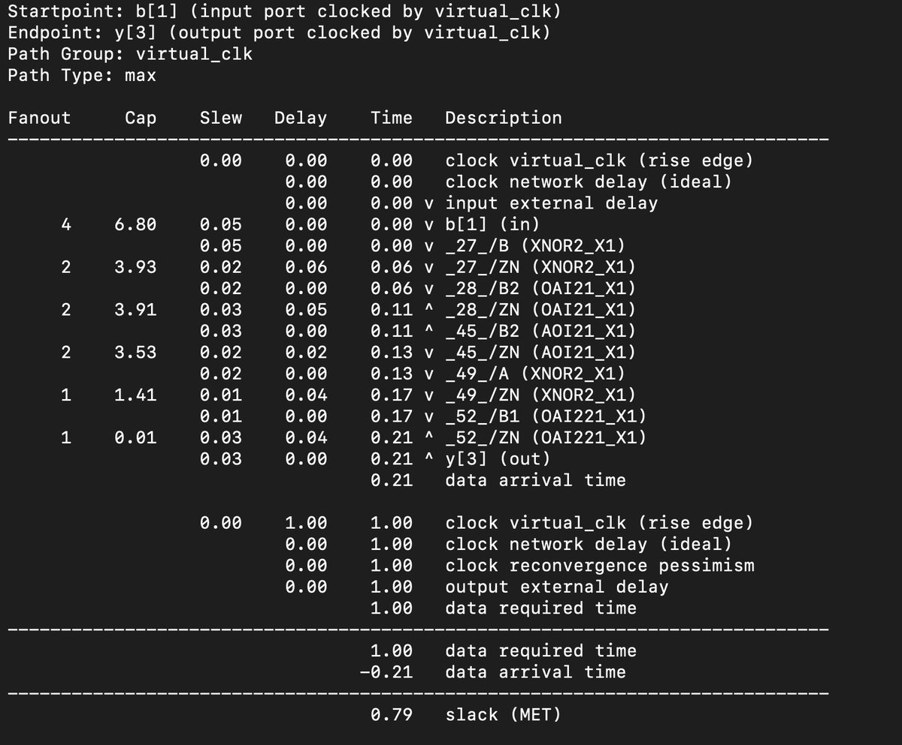
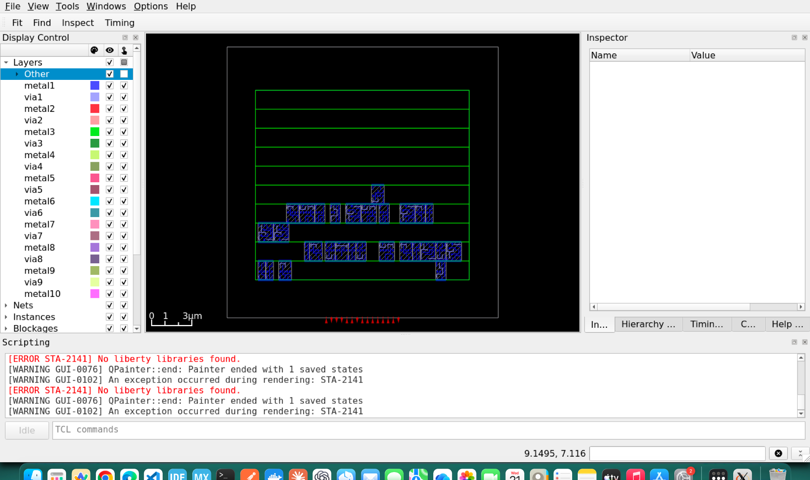
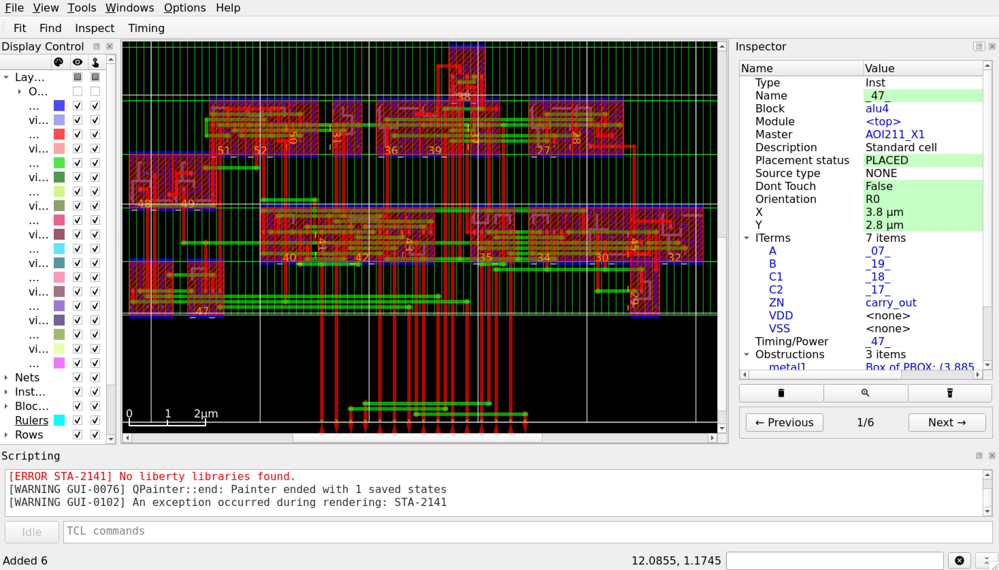

# 🧮 4-bit ALU: RTL to Layout


---


I am learning digital design with an ASIC-first approach. Instead of reading about the chip design flow, I wanted to take one small circuit through all of it myself: writing the RTL, verifying it, synthesizing it into real standard cells, checking its timing, and then placing and routing it into a physical layout. A 4-bit ALU felt like the right size for this. It is small enough that I can understand every gate, but it still has an adder, so there is a real critical path to look at.


Obviously I am not alone in this. I used ChatGPT to take me through this entire workflow. All the tools I used are open source. Yosys for synthesis, OpenROAD for timing and physical design, and the Nangate45 library as the standard cell library.


## What the ALU does


The ALU takes two 4-bit inputs, `a` and `b`, and a 2-bit `op` that selects the operation. It produces a 4-bit result `y` and a `carry_out`.

- `op = 00`: addition. `y` is the lower 4 bits of `a + b`, and `carry_out` is the 5th bit.
- `op = 01`: bitwise AND
- `op = 10`: bitwise OR
- `op = 11`: bitwise XOR

For the logic operations, `carry_out` is always 0.


## Writing the RTL


I wrote the ALU in Verilog as a single `always @(*)` block with a `case` statement on `op`. Every output has to be assigned on every path. If I forget to assign `y` in some branch, the synthesis tool assumes the old value should be held, and it infers a latch. That is not what a combinational circuit should have. So I gave all outputs a default value at the top of the block. Later, Yosys confirmed there were no latches or flip-flops in the design.


## Testing it


Since the inputs are only 10 bits (2, 4 bit numbers and 2 bit input) wide in total, I could test every single combination. The testbench loops over all values of `a`, `b` and `op`, which gives 1,024 cases. For each case, a task computes the expected result, and another task compares it with the ALU output using `!==`. On any mismatch, the simulation stops with `$fatal`.


All 1,024 cases passed. But a passing testbench only means something if it can actually fail. So I broke the RTL on purpose and changed XOR into OR. The testbench caught it at `a = 0001, b = 0001, op = 11`, after about 71 passing cases. Then I restored the correct RTL.


## Synthesis


Before mapping to a standard cell library, Yosys showed 11 high-level cells (things like `$add`, `$and`, `$pmux`). A generic gate-level synthesis turned that into 41 simple gates.


Then I mapped it to the actual Nangate45 standard cells:


```bash
LIB=/OpenROAD-flow-scripts/flow/platforms/nangate45/lib/NangateOpenCellLibrary_typical.lib
yosys -p "
  read_verilog alu4.v
  hierarchy -check -top alu4
  synth -top alu4 -noabc
  dfflibmap -liberty $LIB
  abc -liberty $LIB
  clean
  stat -liberty $LIB
  write_verilog -noattr alu4_mapped.v
"
```


The result was 29 standard cells with a total cell area of 35.378 µm². The cells were mostly compound gates like AOI and OAI, plus five XNORs. The mapped netlist does not look like "an adder, three logic blocks and a mux", because ABC restructures the logic to fit the library cells. Also, 35.378 µm² is just the sum of the cell footprints. It is not the area of the chip.


## Timing before layout


The ALU has no clock, so there is nothing to time against by default. To run static timing analysis, I created a virtual clock with a 1 ns period. Inputs are launched and outputs are captured with respect to this clock. I also set a 50 ps input slew and a 0.01 pF load on the outputs.


The worst path was from `b[1]` to `y[3]`, through five gates:


XNOR2 → OAI21 → AOI21 → XNOR2 → OAI221





It took about 0.21 ns, which leaves +0.79 ns of slack. The other outputs were faster: `y[2]` at 0.18 ns, `carry_out` at 0.16 ns, `y[1]` at 0.14 ns and `y[0]` at 0.12 ns. This makes sense. The higher result bits depend on the carry coming up from the lower bits.


One thing I want to be careful about: this does not tell me the maximum frequency of a chip. The 1 ns clock is something I made up as a reference. This is just a way to measure how long the combinational path takes.


## Floorplan


Now the physical part. A floorplan defines the die (the whole chip area) and the core (the area where cells are placed). I asked for a 20×20 µm die with the core from (2, 2) to (18, 18) µm. OpenROAD snapped the core to the placement grid, so it actually became (2.09, 2.8) to (17.86, 16.8) µm, which is 220.78 µm².


The core is divided into rows of placement sites. Here there are 10 rows, each with 83 sites, and each site is 0.19 × 1.4 µm. Every alternate row is flipped vertically (marked `FS`) so that neighbouring rows can share their power rails.


With 35.378 µm² of cells in 220.78 µm² of core, the utilization is about 16%. That is low, but this is a tiny design anyways.


## Placement


Placement happens in two steps. Global placement spreads the cells out to minimise wire length while keeping density under control. It ran for 369 iterations and ended with an estimated wire length of about 221.6 µm. Global placement allows cells to overlap, so detailed placement then snaps every cell onto a legal site. It fixed 8 overlaps across 4 cells, and the wire length went up to 249.9 µm.


The input and output pins were also placed on the edges of the die, all 15 of them.


When I looked at the layout in the GUI, the five gates of the critical path were not sitting next to each other. The placer optimises all the nets together, not just the critical path, and I did not turn on timing-driven placement.





## Routing


Routing also happens in two steps. Global routing does not draw any wires. It divides the chip into a grid and decides which regions and metal layers each net should pass through. These are saved as route guides. Detailed routing then draws the real wires and vias inside those guides. It finished with 0 violations. The total wire length was 287 µm, 153 µm on metal2 and 134 µm on metal3, with 230 vias.


At this stage there was no power grid yet. Also, 0 violations from the router is not the same as a full DRC and LVS signoff (more on this later).





## Timing after routing


After routing, the wires have real resistance and capacitance. I extracted these parasitics (37 nets, 180 resistor segments, 300 coupling capacitors), wrote them to a SPEF file and ran timing analysis again with the same constraints as before.


With the parasitics actually loaded, the same path went from 211.24 ps to 224.75 ps. That is 13.51 ps, or about 6.4% slower.


The interesting part is where this extra delay shows up. The delay of the wires themselves is tiny here, around 0.24 ps on a net, because the wires are only a few microns long. Most of the increase is inside the gates. Each gate now has to charge its wire capacitance in addition to the input pins it drives, so it takes longer to switch. So in this design the wires slow things down mostly by loading the gates, not by their own RC delay.


## Adding a power grid


Up to this point the cells had VDD and VSS pins, but nothing physically connected them to a supply. So I built a power grid in OpenROAD. It has thin horizontal rails on metal1 that run along every row (this is why alternate rows are flipped, so that neighbouring rows share a rail), vertical straps on metal4, and wider straps on metal7, with vias connecting the layers. So the grid is connected internally, but I have not defined where power comes in (terminals).


The power straps take up space on the metal layers, so I had to route the signals again. This time the detailed router needed a few iterations. The signal wiring grew slightly, from 287 µm to 289 µm, and from 230 to 236 vias.


The critical path went from 224.75 ps to 226.11 ps, which is 1.36 ps (about 0.6%) slower, with +773.89 ps of slack. The second worst path, `b[1]` to `y[2]`, actually got slightly faster, from 187.41 ps to 186.92 ps. The wires simply took slightly different paths around the power grid.


## From layout to GDS


The OpenROAD database refers to each standard cell only by its name and outline. The actual transistor-level shapes of the cells live in the Nangate45 library GDS. GDSII is the format that contains every polygon on every layer, which is what a fab would eventually work with. I used the KLayout technology file generated by OpenROAD-flow-scripts and KLayout's `def2stream.py` to merge my routed DEF with the library cells into `alu4.gds`.


## Checking the layout


This is where the "0 violations" from the router got tested. I ran the FreePDK45 DRC deck in KLayout on the full layout, and it found 4 violations of a rule called WELL.4.


To understand this I had to go one level down. PMOS transistors sit inside an N-well, and NMOS transistors sit in a P-type region. WELL.4 says that a well has to be at least 0.20 µm wide. The four findings were around 0.15 µm wide. One was on the top cell `alu4`, two were inside `OR2_X1` cells and one inside an `AOI211_X1`. One thing to be careful about: this rule is about the width of a well, not about the spacing between an N-well and a P-well.


## Where I stopped


At this point I decided to close the project. The ALU is verified, synthesized, placed, routed with a power grid, timed with real parasitics, and exported to GDS. But it is not a chip that can be manufactured. There are 4 open DRC violations, no LVS, no power terminals, no IR drop or electromigration checks, and all the timing is on a single typical corner with input and output constraints that I made up. Nangate45 is also an educational library, not a real foundry PDK.


I could keep debugging the WELL.4 violations, but that is a physical verification problem. The objective of this exercise was achieved which was to get a good high-level overview of the ASIC Design flow.


## What's next


Next, I am moving on to sequential logic, where clocks, flip-flops, setup and hold time come into the picture. I will start with a D flip-flop and a register, with a testbench that checks the output cycle by cycle, and then build a counter and a small state machine. I will come back to the DRC violations and LVS when I get to physical verification properly in the near future.

